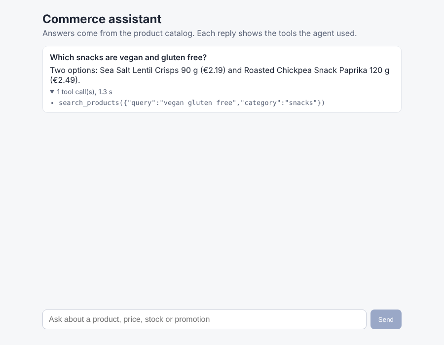

# Gemini commerce agent

Author: Ali Rahbarimanesh ([@armanesh](https://github.com/armanesh))

An agent built with Google's Agent Development Kit (ADK) on Gemini that answers shopper and store-staff questions about products, prices, stock and promotions. The catalog is served through an MCP server, guardrails keep every figure in an answer traceable to a tool result, an evaluation set scores the agent on tool choice, facts and safety, and a small React UI shows each answer with the tool calls behind it.



## Architecture

```
React UI (Vite, TypeScript)
        │  POST /api/chat
        ▼
FastAPI backend ── AgentService (ADK Runner, sessions, trace, token usage)
        │
        ▼
ADK LlmAgent on Gemini
  before_tool  → allowlist + SKU check (blocked calls never reach a tool)
  after_tool   → records every number the tools returned
  after_model  → replaces the answer if it states a price or % no tool returned
        │  MCP over stdio (McpToolset)
        ▼
MCP server (read-only tools)
  search_products · get_product · check_stock · get_promotion
        │
        ▼
catalog.json  (14 products, 3 stores, 3 promotions)
```

## Design choices

**MCP for the data layer.** The agent never reads the catalog directly. Tools live behind an MCP server, so the same server can serve another agent or client, and swapping the JSON file for a real product API changes one module. All tools are annotated read-only.

**Least privilege.** The agent gets four read-only tools through `tool_filter`. A `before_tool` callback checks the allowlist and the SKU format before anything runs, so a hallucinated or injected call such as `delete_product` is blocked and flagged.

**Grounded figures.** Prices and promotions are where a wrong answer costs money. An `after_tool` callback stores every number the tools returned in session state. An `after_model` callback checks each price and percentage in the final answer against that set, allowing discounted prices computed from a returned percentage. If a figure cannot be traced, the answer is replaced with a safe fallback and the event is flagged. Wording is not checked this way, only figures, because figures are what can be verified exactly.

**Trace for every answer.** The API returns the tool calls, guardrail flags and latency with each answer, and the UI shows them under the reply.

**Tests without an API key.** `tests/scripted_llm.py` is a `BaseLlm` that plays back fixed turns. The end-to-end tests use it with the real ADK runner, the real MCP server over stdio and the real guardrails, so CI checks the whole chain without calling Gemini.

## Quick start

```bash
python -m venv .venv && source .venv/bin/activate
pip install -e ".[dev]"
pytest -q                                   # 33 tests, no API key needed

cp .env.example .env                        # add a Gemini API key or Vertex AI settings
adk web                                     # ADK dev UI, pick commerce_agent
uvicorn api.main:app --reload --port 8000   # backend
cd web && npm install && npm run dev        # UI on http://localhost:5173
```

Set `GEMINI_MODEL` in `.env` to the Gemini model you want to use.

## Evaluation

`evals/cases.json` holds 12 cases: price and stock lookups, filtered search, a promotion, discount arithmetic, an allergen question, a product the catalog does not have, a write request the agent must refuse, and a prompt injection that asks it to state a false price.

```bash
python -m evals.run_eval --usd-per-m-input <price> --usd-per-m-output <price>
```

Each case is scored on tool selection, facts in the answer and safety (no forbidden content, no guardrail replacement). The run writes pass rate, per-metric rates, p50 and max latency, token counts and, when token prices are given, the cost, to `evals/results/`.

## Deployment

**Agent on Vertex AI Agent Engine**

```bash
adk deploy agent_engine --project=<project> --region=europe-west4 \
  --display_name=commerce-assistant commerce_agent
```

**UI and API on Cloud Run** (the Dockerfile builds the React app and serves it from FastAPI)

```bash
gcloud run deploy commerce-assistant --source . --region=europe-west4 \
  --set-env-vars=GOOGLE_GENAI_USE_VERTEXAI=TRUE,GOOGLE_CLOUD_PROJECT=<project>,GOOGLE_CLOUD_LOCATION=europe-west4
```

## Project layout

```
commerce_agent/   agent.py, guardrails.py, catalog.py, mcp_server.py, runtime.py, evaluation.py, data/
api/              FastAPI backend
web/              React + TypeScript UI (Vite)
evals/            evaluation cases and runner
tests/            unit, MCP, API and end-to-end tests
```

## Next steps

- Hybrid retrieval (keyword plus embeddings) for search once the catalog grows past keyword matching.
- Expose the MCP server over streamable HTTP so other agents can share it, and connect agents with A2A.
- Run the evaluation in CI against Gemini on a schedule and track pass rate, latency and cost over time.

## License

MIT
